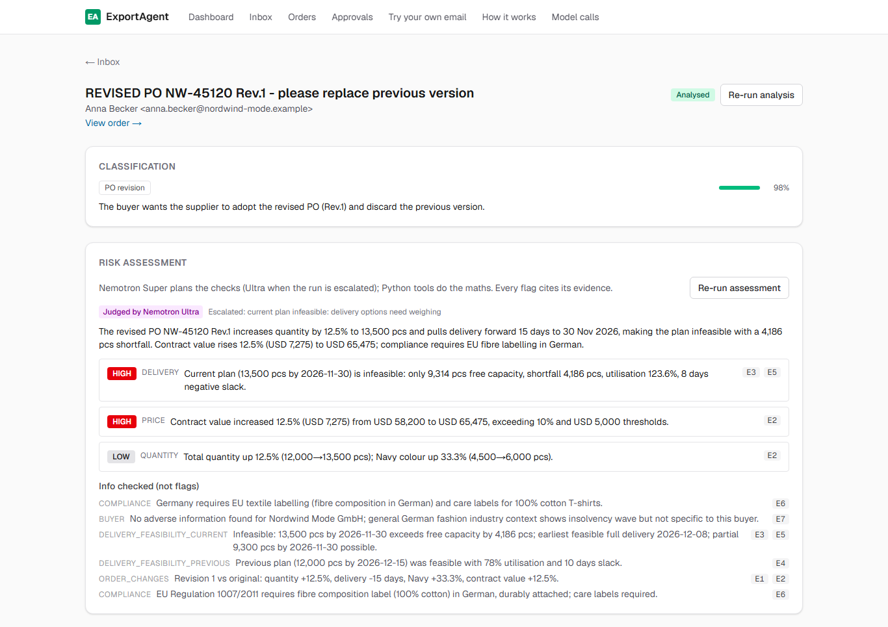
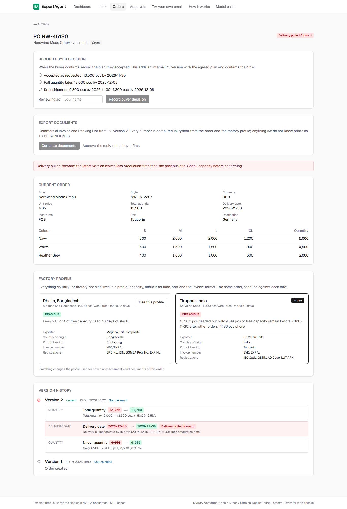
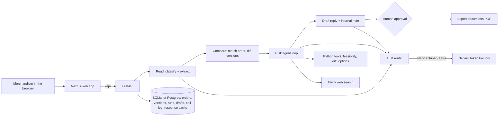

# ExportAgent

**An AI export desk for apparel and textile exporters.** A buyer's email arrives, and ExportAgent:
- reads it and extracts the purchase order;
- finds what changed against the previous version of the order;
- checks whether the factory can still deliver;
- drafts the reply;
- produces the Commercial Invoice and Packing List.

A person approves every step. The models are NVIDIA Nemotron Nano, Super and Ultra, called at runtime on Nebius Token Factory.

Built for the **Nebius × NVIDIA Global AI Hackathon**, track: Best Apps and Agents.

**Live demo: <https://3-104-80-176.sslip.io>.** No sign-up, and the demo data is preloaded. Walkthrough below.



## The problem

A small exporter in Tiruppur or Dhaka gets dozens of buyer emails a day: new POs, revisions, "please pull delivery forward", sample requests. They arrive in German, Spanish and Japanese, with size tables in the body, PDFs attached and long reply threads.

The costly mistakes are quiet ones:
- a revision that raises the quantity 12% *and* pulls the ex-factory date forward two weeks;
- a "small change" that pushes the order past the factory's free capacity.

These are found weeks later, when air freight is the only way to make the date.

ExportAgent reads every email the way a careful merchandiser would. Every number it relies on is computed in plain Python, never by a model. The model's job is to read, plan the checks and write.

## Try it in 2 minutes

The public demo is shared. If someone else has already clicked through, press **Reset the demo** at the bottom of the dashboard.

1. **Dashboard.** Open orders, drafts awaiting approval, high risks and today's AI spend against the cap. Click **Start the demo story**.
2. **The email.** It's a revised PO from a German buyer, *"REVISED PO NW-45120 Rev.1"*.
   - **Classification and extraction:** Nemotron Nano classified it as a *PO revision* and extracted every field. Each field has a confidence score and the exact quote it came from (bottom of the page).
   - **Risk assessment:** the risk check went to **Nemotron Ultra**, because the Python pre-check found the current plan infeasible. It reports two **high** flags:
     - *13,500 pcs by 30 Nov is infeasible: 4,186 pcs short*;
     - *contract value +12.5% (USD 7,275)*.
   - **Evidence:** every flag cites evidence (E1–E7), and each one is a Python tool result or a web source.
   - **Trace:** shows each step, with model, tokens, latency and cost.
3. **The reply.** Nemotron Super drafted it. It offers two options that Python computed: the full quantity on 8 Dec, or a split of 9,300 pcs on 30 Nov and 4,200 on 8 Dec. A Python fact check verified all 14 values in it. Type your name, then **Approve and mark sent**. Nothing is actually emailed.
4. **The order.** Click **View order**.
   - **Version history:** shows the change from v1 with *Delivery pulled forward* highlighted.
   - **Record buyer decision:** choose **Split shipment**, then **Record buyer decision**.
5. **Documents.** Click **Generate documents**: one Commercial Invoice and one Packing List per shipment, as PDFs.
   - Every amount, carton count and weight is computed in Python.
   - Anything ExportAgent does not know, such as consignee or bank details, prints in red as **TO BE CONFIRMED** instead of being guessed.
6. **Factory profile.** On the same order page, the same revision is **infeasible** for the Tiruppur factory but **feasible** for the Dhaka one (72% of free capacity used). Switching the profile also changes the exporter, port and invoice format.
7. **Model calls** and **How it works.** Every model call ExportAgent has made, and the routing design with its measured cost.
8. **Try your own email.** Paste a buyer email or upload a PO as a PDF, and the whole pipeline runs live in about a minute. Live calls stop at **$1 a day**. After that, the demo still works from stored results.



## How it uses NVIDIA Nemotron on Nebius Token Factory

Every model call goes through one module, [backend/app/llm/router.py](backend/app/llm/router.py). It uses the OpenAI-compatible Token Factory API. Callers name a *task*, never a model, and the router picks the Nemotron tier.

| Task | Model | Why this tier |
|---|---|---|
| Classify, extract the PO, detect stated changes | **Nano** (thinking off) | High volume, structured JSON. With thinking on, Nano spent its token budget reasoning and returned no JSON |
| Re-read one field that failed a Python check | **Super** | Only the failing field, only when Nano demonstrably got it wrong |
| Risk agent: plan the checks, judge the evidence | **Super**, escalated to **Ultra** | Super by default; Ultra only when a run needs it (below) |
| Reply to the buyer, internal note for production | **Super** (thinking on) | Writing quality at moderate cost |

**Escalation in extraction.** Nano extracts every field. Python then checks three things:
- the size breakdown adds up;
- no size table in the email was missed;
- the quoted source text is really in the email and states the value.

Only a field that fails is re-read by Super, and Super's value is kept only if the same check then passes. In the final evaluation, 70% of emails needed Nano alone, and Super resolved 91% of the escalated fields ([escalation.py](backend/app/services/escalation.py)).

**Routing in the risk agent.** On all three evaluation sets, Super found the same high-risk issues as Ultra at a quarter to a fifth of the risk-stage cost, so Super runs every assessment. Ultra takes over the whole run in four cases ([routing.py](backend/app/agent/routing.py)):
- the Python pre-check says the current plan is infeasible, so delivery options need weighing;
- the email or thread mentions something that can change feasibility, such as "fabric is in-house" or a partial shipment;
- Super's flags contradict the Python feasibility result;
- Super's report fails validation.

The risk card on each email shows which model judged it and why. In the final evaluation, 21% of risk runs went to Ultra.

**Cost per email, all models, measured live with the cache off on 35 DEV emails: $0.0094.**

| Stage | Model | Per email |
|---|---|---|
| Classify and extract, plus escalations | Nano, Super | about $0.0004 |
| Risk agent (on emails with an order) | Super, Ultra on escalation | $0.0064 per assessed email |
| Reply and internal note | Super | about $0.003 |

Model IDs, prices and per-task tiers come from environment variables ([.env.example](.env.example)), so tiers can change without code changes. Every call is logged with task, tier, model, tokens, latency, cost and source (live or cache), and the **Model calls** page reads that log.

| Tier | Model ID (verified against `/v1/models`) | USD per 1M tokens (in / out) |
|---|---|---|
| Nano | `nvidia/NVIDIA-Nemotron-3-Nano-30B-A3B` | 0.06 / 0.24 |
| Super | `nvidia/nemotron-3-super-120b-a12b` | 0.30 / 0.90 |
| Ultra | `nvidia/Nemotron-3-Ultra-550b-a55b` | 1.00 / 3.00 |

## The risk agent

The agent runs an observe → reason → act loop with tool calling. It is capped at 8 tool rounds and has `max_tokens` on every call ([loop.py](backend/app/agent/loop.py)). The checks every order needs are run in Python first, and their results are handed to the model as evidence. The model then decides which optional checks to run, and makes the final judgement. All arithmetic is in the tools:

| Tool | What it does |
|---|---|
| `find_order` | The order and every stored PO version |
| `diff_po_versions` | Old → new changes between versions, with the *delivery pulled forward* alert |
| `check_delivery_feasibility` | Free capacity and fabric lead time from the factory profile, minus other orders due in the same window. It can also run a what-if, such as "fabric is already in-house" |
| `propose_delivery_options` | For an infeasible plan: the earliest date for the full quantity, and the split that ships on time |
| `check_compliance` | Tavily web search for the destination's import and labelling rules, with source URLs |
| `lookup_buyer` | Tavily web search for background on buyers with no earlier orders |

**Why a loop and not a fixed pipeline: the what-if.** In DEV case_007, the buyer pulls PO NW-45098 forward from 24 to 10 November. The pre-check says that's infeasible, because the 42-day fabric lead time leaves only 9 production days. Further down the thread, though, the factory's own merchandiser wrote "fabric is in-house". Ultra reads that and runs `check_delivery_feasibility` again with `fabric_ready=true`. It gets *feasible, 35 days of slack*, and reports a medium "confirm the new date" flag instead of a false high alarm. Deciding that a different question needs asking is the model's job. Answering it stays in Python.

**Flags must be earned.** A policy file ([risk_policy.yaml](backend/policy/risk_policy.yaml)) is enforced in Python ([risk_policy.py](backend/app/services/risk_policy.py)):
- **Evidence:** it must point at a real tool result or a URL a tool returned.
- **Compliance flags** must name a concrete rule and its source.
- **Buyer flags** need an adverse finding.
- **High severity** is reserved for an infeasible plan or a contract-value change above 10% or 5,000.
- **A date that can be read two ways** (03/04) never drives a high schedule finding. It becomes one medium "confirm the date" flag, and the reply asks the buyer.

Anything that falls short moves to *Info checked*.

## What Python guarantees

- **Drafts are fact-checked.** Super writes from facts assembled in Python: the order, its versions, the flags and the delivery options. Other buyers' orders are never included. Every date, quantity and price in the draft is then checked against those facts and the buyer's email ([fact_check.py](backend/app/services/fact_check.py)). Approving a draft with an open violation needs an explicit acknowledgement.
- **Nothing is sent automatically.** Every draft waits in **Approvals** to be edited (and re-checked), approved or rejected, and the reviewer's name and time are recorded.
- **Orders are versioned, never overwritten.** Each email that carries order data is matched to its order with a scored match: PO number with revision suffixes stripped, the PO named in the text, or the same style, buyer and nearby date. An uncertain match becomes a question for a person rather than a duplicate order ([order_matching.py](backend/app/services/order_matching.py)).
- **Documents are computed, not written.** The Commercial Invoice and Packing List are built with ReportLab ([documents/](backend/app/services/documents/)):
  - line amounts are rounded half-up to the currency's minor unit, and the total is the sum of the rounded lines;
  - the amount is written out in words;
  - cartons are counted per colour and size, plus net and gross weight and volume;
  - HS codes and carton specs come from a catalogue ([styles.yaml](backend/catalog/styles.yaml));
  - exporter registrations and declarations come from the factory profile (India: IEC, GSTIN, LUT; Bangladesh: ERC, BIN, BGMEA);
  - anything else is printed as **TO BE CONFIRMED**.
- **Country and factory specifics live in profiles** ([backend/profiles/](backend/profiles/)): capacity, fabric lead time, ports, Incoterms and invoice format. Adding a country means adding a profile. All company names are fictional, and the capacity figures are illustrative.

## Evaluation

Synthetic buyer emails modelled on real export paperwork, each with a hand-written expected output for every field, line item, change, review flag, order match and high-risk finding. The full pipeline ran **live on Nemotron with the cache off**.

- **DEV** (35 cases): fixes are made only against these.
- **TEST v2** (30 cases, held out): written by a separate assistant session from [the spec](backend/eval/TEST_V2_SPEC.md) alone, and committed before any run. Nothing was tuned on it.

| Metric | DEV, final pipeline | **TEST v2, held out** (3 runs) |
|---|---|---|
| High-risk findings: recall | **100%** | **100%** |
| High-risk findings: precision | 100% | 80.1% |
| Field extraction accuracy | 98.7% | 96.5% |
| Line items (colour, quantity, sizes) | 98.4% | 83.2% |
| Email put on the right order | 100% | 98.7% |
| Change detection: recall / precision | 96.3% / 92.9% | 77.4% / 56.4% |
| Classification: main category | 94.3% | 87.6% |
| Drafts with no fact-check violations | 97.1% | 97.1% |
| Cost per email, all models | **$0.0094** | $0.0215* |

\* TEST v2 ran while Ultra still did every risk assessment. With Super for risk on the same set: the same 100% recall, 85.7% precision and $0.0063 per email.

**The held-out column is the honest number.** It found weaknesses DEV didn't have:
- ambiguous numeric dates read the wrong way round;
- a status question misread as a date change, which raised a false schedule risk;
- unfamiliar revision suffixes;
- colour-level change wording.

Each was fixed against new DEV cases only, never against TEST v2, and the held-out results are kept exactly as first published.

**The routing decisions are measured, not assumed.** All on DEV:

| Setup | High-risk precision / recall | Risk-stage cost per assessed email |
|---|---|---|
| **Super, escalating to Ultra (ours)** | 89.7% / 100% | **$0.0093** |
| Ultra for every risk run | 76.9% / 90.9% | $0.0189 |

| Setup | Field accuracy | Line items | Change recall | Cost per email |
|---|---|---|---|---|
| **Routed (ours, at the time)** | 98.8% | 94.7% | 98.0% | $0.0188 |
| Nano for everything | 96.0% | 81.8% | 76.5% | $0.0036 |
| Ultra for everything | 99.0% | 100% | 100% | $0.0301 |

Full tables, baselines, per-case results, what still fails and caveats are in **[backend/eval/REPORT.md](backend/eval/REPORT.md)**.

## Architecture



| Folder | What's in it |
|---|---|
| `backend/app/llm/` | The router: tiers, response cache, spend cap, call log |
| `backend/app/agent/` | The risk agent loop, routing and tools |
| `backend/app/services/` | Extraction checks, escalation, order matching, risk policy, fact check, documents |
| `backend/eval/` | Datasets, harness and report |
| `web/` | Next.js app: dashboard, inbox, email, order, approvals, try-your-own, model calls |
| `deploy/` | Production Docker Compose, Caddy, setup and backup scripts |

## Run it locally

Everything builds from source; no registry login or token is needed. The demo inbox comes with its analyses, risk assessments and drafts stored, so the whole walkthrough above works **without any API key**. A key is only needed for pasting new emails and for the **Re-run** buttons; without one, a re-run says so and keeps the stored result on screen. `LLM_MODE=mock` runs everything with a rule-based stand-in instead.

**With Docker** (Postgres, API and web, with the demo loaded on first start):

```bash
cp .env.example .env              # optional: add NEBIUS_API_KEY and TAVILY_API_KEY for live runs
docker compose up --build         # http://localhost:3000
```

**Without Docker** (Python 3.11+, Node.js 20+):

```bash
cd backend
python -m venv .venv
.venv/Scripts/activate            # macOS/Linux: source .venv/bin/activate
pip install -e ".[dev]"
alembic upgrade head
python -m scripts.load_demo       # 8 analysed demo emails with their runs, drafts and cached responses
uvicorn app.main:app --reload --port 8000
```

```bash
cd web
npm install
npm run dev                       # http://localhost:3000
```

With a Nebius key, you can rebuild the demo live from the raw emails with `python -m scripts.seed --analyse --agent --drafts`.

Checks, from `backend/`:

```bash
pytest                                          # 517 unit tests, no network
python -m scripts.smoke_llm                     # one live call per Nemotron tier: model, tokens, latency, cost
python -m eval.run_eval --split dev --run 1     # one end-to-end evaluation pass
python -m eval.report                           # rebuilds eval/REPORT.md
```

## The public deployment

The live demo runs on one AWS EC2 t4g.micro (ARM, 1 GB RAM) in Sydney, for about $12 a month. GitHub Actions builds the arm64 and amd64 images and pushes them to a private GitHub Container Registry; the server only pulls them. Caddy provides HTTPS. Details, resource IDs, the load test and teardown are in **[DEPLOY.md](DEPLOY.md)**.

Guards on the public demo:
- **Response cache:** a request that was answered before is served from the cache at no cost.
- **Daily spend cap:** $1 of live model calls per day (UTC). After that, everything still works from stored results, and resetting the demo cannot reset the cap.
- **Rate limit:** 10 model-triggering requests per minute per IP.

## What we'd improve

From the evaluation:
- **Dates and status emails:**
  - settle ambiguous dates from the buyer's country and the other dates in the thread;
  - stop status questions that mention a date being read as date changes, the one false high-risk pattern left on TEST v2.
- **Revisions and colours:**
  - learn more revision-suffix formats;
  - read "colour X cancelled" as a removal, not a quantity change.
- **Failed classifications:** retry a malformed classification reply on Super instead of failing the email.

Product:
- **Email:** connect a real mailbox (Gmail or IMAP), and send approved replies from it.
- **PDFs:** OCR scanned PO PDFs. Today only PDFs with a text layer are read.
- **Accounts:** add sign-in and roles (merchandiser, manager), and keep an audit trail per user.
- **Capacity:** take it from the factory's ERP instead of a profile file.
- **Coverage:** add more country profiles, such as Vietnam, Türkiye and Sri Lanka.

## License

MIT. See [LICENSE](LICENSE).
